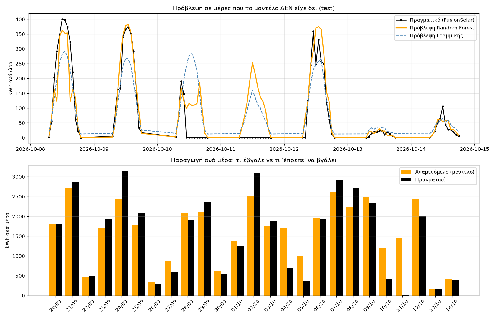
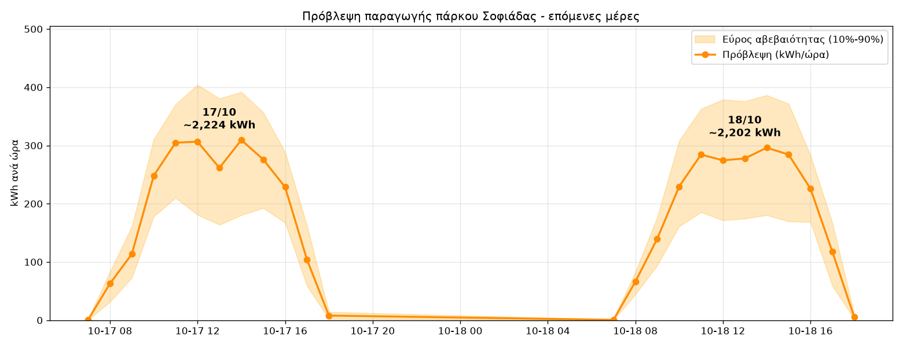

# ☀️ PV Forecast: Πρόβλεψη παραγωγής φωτοβολταϊκού πάρκου 500 kW από τον καιρό, με Machine Learning

> 🇬🇧 **[English version →](README.en.md)**

Ένα ολοκληρωμένο σύστημα Machine Learning που μαθαίνει πώς **ο καιρός καθορίζει την παραγωγή** ενός πραγματικού
φωτοβολταϊκού πάρκου 500 kW στην κεντρική Ελλάδα (δεδομένα από το Huawei FusionSolar). Το χρησιμοποιεί για να:

1. **Προβλέπει** την ωριαία παραγωγή (kWh) των επόμενων ημερών από την πρόγνωση του καιρού
2. **Μαθαίνει από καθαρά δεδομένα.** Οι ώρες που το πάρκο είχε περικοπή ή ήταν εκτός λειτουργίας εντοπίζονται και βγαίνουν από την εκπαίδευση, ώστε το μοντέλο να μάθει την κανονική συμπεριφορά του πάρκου.
3. **Στέλνει καθημερινή αναφορά** στο Telegram, πλήρως αυτοματοποιημένα με το **n8n**

---

## 🎯 Βασικά αποτελέσματα

| | Μέσο σφάλμα MAE (kWh/ώρα) | R² |
|---|---|---|
| Γραμμική παλινδρόμηση (μόνο ακτινοβολία), μοντέλο αναφοράς | 35,4 | 0,860 |
| Random Forest (6 μεταβλητές καιρού) | 24,9 | 0,883 |
| **Random Forest + επαναληπτικός καθαρισμός δεδομένων** | **18,7** | **0,943** |

*Όλα τα μοντέλα αξιολογήθηκαν στις ίδιες 71 ώρες κανονικής λειτουργίας μιας εβδομάδας που κρατήθηκε χρονολογικά
εκτός εκπαίδευσης (8–14 Οκτ 2026, χωρίς διαρροή δεδομένων). Ο καθαρισμός μείωσε το σφάλμα του Random Forest κατά 25%.*

**Ο έλεγχος ποιότητας επιβεβαιώθηκε στην πράξη:** χωρίς καμία ετικέτα, το βήμα καθαρισμού εντόπισε τις
**10 και 11 Οκτωβρίου 2026** ως μέρες που το πάρκο σχεδόν δεν παρήγαγε, ενώ ο καιρός έδειχνε ακτινοβολία έως ~480 W/m²
(στις 11/10 έβγαζε σταθερά ~0,55 kWh κάθε ώρα). Ο ιδιοκτήτης επιβεβαίωσε ότι **το πάρκο ήταν εκτός λειτουργίας και τις δύο μέρες**.

*Πρόβλεψη vs πραγματικό στην εβδομάδα αξιολόγησης (πρώτο μοντέλο, πριν τον καθαρισμό). Οι δύο μέρες στο μηδέν είναι τα σταματήματα:*



*Παράδειγμα: πρόβλεψη για τις επόμενες δύο μέρες με εύρος αβεβαιότητας:*



---

## 🧠 Πώς λειτουργεί

```
 Huawei FusionSolar           Open-Meteo API
 (ωριαία παραγωγή, kWh)       (ακτινοβολία στο κεκλιμένο πάνελ, άμεση/διάχυτη,
          │                    θερμοκρασία, νεφοκάλυψη)
          └──────────┬─────────┘
                     ▼
        02  Ένωση & ευθυγράμμιση ωρών
                     ▼
        03  Εκπαίδευση Random Forest ◄──┐  Καθαρισμός δεδομένων (βελτιώνει το μοντέλο):
            αφαίρεση μη κανονικών ωρών ─┘  προβλέψεις εκτός δείγματος (GroupKFold ανά μέρα),
                     │                      αφαίρεση ωρών με <20% του αναμενόμενου, ξανά εκπαίδευση
                     ▼
        04  Πρόβλεψη επόμενων ημερών (+ εύρος αβεβαιότητας από τα 300 δέντρα)
                     ▼
        05  Ημερήσια αναφορά (κείμενο)
                     ▼
        Το n8n τρέχει 02→05 κάθε πρωί στις 07:30  ──►  Telegram
```

### Σημαντικές τεχνικές αποφάσεις
- **Χρονολογικός διαχωρισμός εκπαίδευσης/αξιολόγησης.** Το μοντέλο προβλέπει πάντα το μέλλον από το παρελθόν.
- **Ευθυγράμμιση ωρών.** Στο Open-Meteo η τιμή μιας ώρας είναι ο μέσος όρος της ώρας που *τελειώνει*, ενώ στο FusionSolar της ώρας που *αρχίζει*. Ο καιρός μετατοπίζεται κατά μία ώρα ώστε να περιγράφουν το ίδιο διάστημα.
- **GroupKFold cross-validation ανά μέρα** για τον εντοπισμό ανωμαλιών. Έτσι μια ώρα δεν κρίνεται ποτέ από μοντέλο που την έχει ήδη δει (ή άλλες ώρες της ίδιας μέρας).
- **Ρύθμιση ορίου με έλεγχο λογικής.** Όριο 60% σημάδευε ~30% των ωρών και έβγαζε μη ρεαλιστική απώλεια 45%, γιατί μπέρδευε λάθη πρόγνωσης καιρού με περικοπές. Όριο 20% απομονώνει μόνο τα πραγματικά σταματήματα.
- **Εκτίμηση αβεβαιότητας.** Χρησιμοποιείται το 10ο–90ό εκατοστημόριο των προβλέψεων των επιμέρους δέντρων.
- **Ιδιωτικότητα.** Η ακριβής θέση του πάρκου υπάρχει μόνο σε τοπικό αρχείο `.env`, και ο δημόσιος κώδικας χρησιμοποιεί στρογγυλεμένη θέση.

### Σημαντικότητα μεταβλητών (Random Forest, μοντέλο αξιολόγησης)
| Μεταβλητή | Σημαντικότητα |
|---|---|
| Ακτινοβολία στο κεκλιμένο πάνελ | 36,6% |
| Άμεση ακτινοβολία | 27,7% |
| Διάχυτη ακτινοβολία | 15,7% |
| Θερμοκρασία | 12,5% |
| Νεφοκάλυψη | 4,6% |
| Ώρα της μέρας | 2,9% |

---

## 📁 Δομή του project

| Αρχείο | Τι κάνει |
|---|---|
| `config.py` | Κοινές ρυθμίσεις, διαβάζει το ιδιωτικό `.env` |
| `01_kairos.py` | Κατεβάζει δεδομένα καιρού και φτιάχνει γράφημα ακτινοβολίας |
| `02_ekpaideusi.py` | Ενώνει παραγωγή + καιρό, εκπαιδεύει μοντέλο αναφοράς & Random Forest |
| `03_katharismos.py` | Καθαρισμός δεδομένων: αφαιρεί ώρες περικοπής/εκτός λειτουργίας και ξαναεκπαιδεύει |
| `04_provlepsi.py` | Πρόβλεψη επόμενων ημερών με εύρος αβεβαιότητας |
| `05_anafora.py` | Γράφει τη σύντομη ημερήσια αναφορά |
| `n8n_kathimerina.sh` | Τρέχει όλο το pipeline (02→05), το καλεί το n8n |
| `n8n/pv_forecast_workflow.json` | Workflow του n8n: χρονοδιακόπτης → Python → Telegram |

---

## 🚀 Εκτέλεση

```bash
python3 -m venv .venv && source .venv/bin/activate
pip install -r requirements.txt
cp .env.example .env            # βάλε εδώ τις δικές σου συντεταγμένες
# βάλε τα αρχεία FusionSolar "Plant Statistics Report by Time" (.xlsx) στο data/fusionsolar/
python3 02_ekpaideusi.py && python3 03_katharismos.py && python3 04_provlepsi.py && python3 05_anafora.py
```

**Αυτοματοποίηση:** εισήγαγε το `n8n/pv_forecast_workflow.json` στο n8n, όρισε τη διαδρομή του script, το credential
του Telegram bot και το chat ID, και πάτα Publish. (Στο n8n 2.x ο κόμβος *Execute Command* ενεργοποιείται με τη μεταβλητή
περιβάλλοντος `NODES_EXCLUDE="[]"`.)

> Τα δεδομένα παραγωγής του πάρκου είναι ιδιωτικά και δεν περιλαμβάνονται στο repository.

---

## 🗺️ Επόμενα βήματα
- [x] Pipeline δεδομένων καιρού + παραγωγής
- [x] Πρόβλεψη με Random Forest, καθαρισμός δεδομένων & εύρος αβεβαιότητας
- [x] Καθημερινή αυτοματοποίηση με n8n + Telegram
- [ ] Αυτόματη λήψη του καθημερινού email του FusionSolar (Gmail)
- [ ] **AI agent** (LLM) που εξηγεί σε απλή γλώσσα την πρόβλεψη και κάθε ασυνήθιστη μέρα
- [ ] Λειτουργία στο cloud (GitHub Actions) ώστε να τρέχει 24/7
- [ ] Μεγαλύτερο ιστορικό (εποχικότητα) και περισσότερες μεταβλητές καιρού
- [ ] Ειδοποιήσεις σφαλμάτων

## 🛠️ Τεχνολογίες
Python · pandas · scikit-learn · matplotlib · REST APIs (Open-Meteo) · n8n · Telegram Bot API

## 👤 Δημιουργός
**Βαγγέλης Γκουζέλος**: πτυχιούχος Μαθηματικών, μεταπτυχιακός φοιτητής στα Προηγμένα Συστήματα Πληροφορικής (Τεχνητή Νοημοσύνη & Ανάπτυξη Λογισμικού), Πανεπιστήμιο Πειραιώς.
